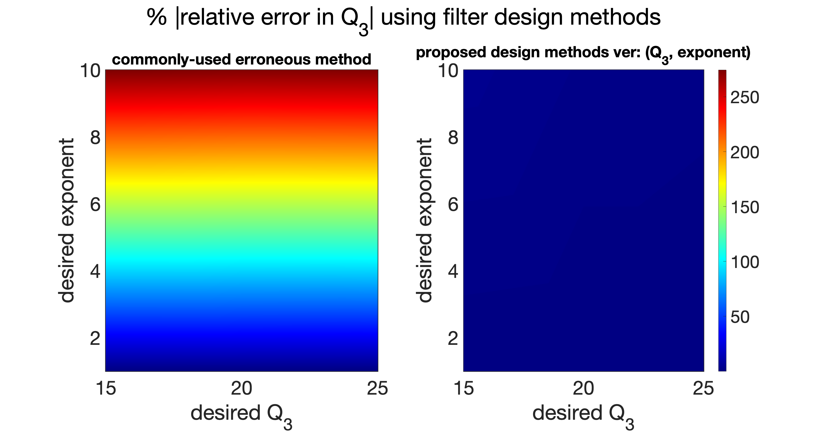
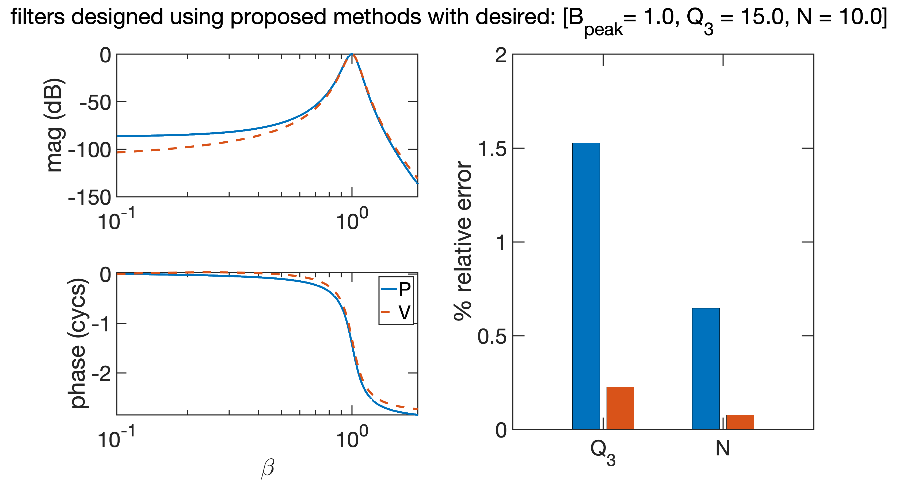

# VCCA2025

## Conference
[Virtual Conference on Computational Audiology 2025](https://computationalaudiology.com/events/vcca2025/)

## Title
Accurate Methods for the Design of Auditory Filters Based on Bandwidth and Delay Specifications

## Author
Samiya A Alkhairy

## Once-Sentence Summary
We develop methods that (1) enable accurate design of auditory filterbanks based on desired specifications for peak frequencies, bandwidths, and delays and also (2) allow for very systematically studying the effect of varying filter characteristics on perceptual tasks and on improving speech and hearing technologies.

## Abstract
**Background:**
Auditory filterbanks are fundamental to technologies as well as perceptual models and studies. It is generally desirable to tune these filters to mimic the behavior of the human auditory system. Auditory filters are typically designed by imposing a value for the half-power quality factor or bandwidth of the corresponding pole-pair (or equivalently, the related second order system - SOS). However, we show that this imposed SOS quality factor is not equivalent to the quality factor of higher-order auditory filters. This motivates our goal of developing simple highly accurate methods for the design of auditory filters based on the characteristics of these filters themselves. These characteristics include the peak frequency, peak magnitude, 3 dB bandwidth, 15 dB bandwidth, equivalent rectangular bandwidth, and group delay at the peak. 

**Methods:**
To develop our characteristics-based design methods, we derive parameterizations for the auditory filters in terms of sets of the filter characteristics mentioned above. To do so, we derive expressions for the filter characteristics in terms of the filter constant (transfer function pole and exponent), then invert these to derive expressions for the filter constants in terms of characteristics. This allows us to parameterize the filters using these desired characteristics.

**Results:**
The methods are direct, simple, inherently causally-stable, computationally efficient, highly accurate in achieving strict and simultaneous specifications on characteristics, and do not rely on iterative processes with local minima. These properties are collectively not found in existing methods for the design of auditory filter.

**Conclusions:**
In developing the characteristics-based filter design methods, we do not erroneously extrapolate from characteristics-based design of second order filters and instead derives characteristics-based parameterized expressions from first principles as is appropriate for auditory filters of any order. The develop methods enable accurate design of auditory filters based on desired specifications on characteristics. In addition, they enable systematically studying the effect of varying filter characteristics on perceptual tasks and aid in advancing technologies for machine hearing and speech recognition.

## Figures for Abstract

Commonly used erroneous methods for designing auditory filters extrapolated from second order filters are highly inaccurate (left). The proposed methods that we derived from first principles enable comparatively highly accurate filter design using specifications of desired characteristics such as values of half-power quality factors (right).

We design auditory filters including GEFs/P/APGFs (blue) and V/~OZGFs (red) by specifying various sets of characteristics - e.g. peak normalized frequency, 3-dB quality factor, and normalized group delay. The figure below shows the Bode plots (as a function of normalized frequency) of the filters designed using the proposed methods (magnitude - top left, phase - bottom left), along with the percentage relative error in achieving desired characteristics which is less than 1.5% in this case (right).
